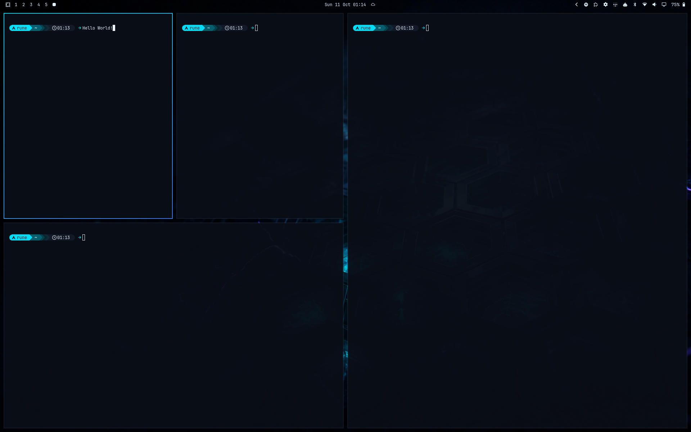
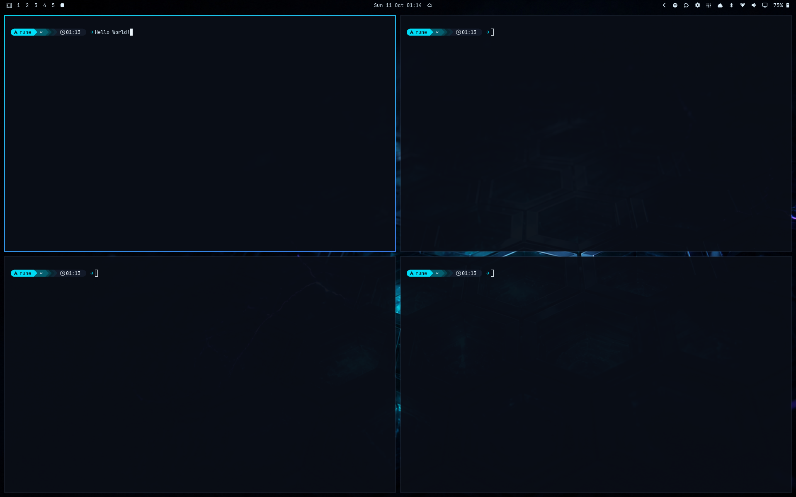

# Omarchy Grid Layout

An equal-size **grid layout** for [Omarchy](https://omarchy.org/) (Hyprland), added as a third step to Omarchy's `SUPER + L` layout toggle.

Omarchy ships with `dwindle` and `scrolling`. With dwindle every new window splits the focused one, so four windows end up as one large, one medium and two small. The grid layout gives every tiled window on the workspace the same size.

| Dwindle (stock) | Grid |
|---|---|
|  |  |

---

## ✨ Features

- **Equal-size grid**: 4 windows = 2×2, 5–6 = 3×2, 7–9 = 3×3. The number of columns is `ceil(sqrt(n))`.
- **Three-way toggle**: `SUPER + L` cycles **dwindle → scrolling → grid** on the active workspace.
- **Remembered per workspace**: the choice is saved the same way as Omarchy's own toggle (`~/.local/state/omarchy/workspace-layouts/`), so it survives reloads and logins.
- **No stale window sizes**: includes a workaround for a Hyprland issue where windows keep their old size after a layout change (see below).
- **Small**: the layout itself is about 15 lines of Lua, built on Hyprland's own `example/layouts/grid.lua`.

## Requirements

- Omarchy with the Lua Hyprland config (Hyprland **0.55 or newer**). Custom Lua layouts (`hl.layout.register`) do not exist in older versions.
- Tested on Hyprland 0.56.2.

---

## 🚀 Installation

```bash
git clone https://github.com/Dessection/omarchy-grid-layout.git
cd omarchy-grid-layout
./install.sh
```

The installer:

1. Copies `grid-layout.lua` to `~/.config/hypr/` and the cycle script to `~/.config/hypr/scripts/`.
2. Adds `require("hypr.grid-layout")` to `~/.config/hypr/hyprland.lua` (after taking a backup), above `require("default.hypr.toggles")`, so the layout is registered before Omarchy restores saved workspace layouts.
3. Reloads Hyprland and checks for config errors.

Running it again is safe. It does not add the line twice.

## 🔄 Updating

```bash
cd omarchy-grid-layout
git pull
./install.sh
```

## 🗑️ Uninstallation

```bash
./uninstall.sh
```

This removes the files and the `require` line, switches workspaces saved as grid back to dwindle, and gives `SUPER + L` back to Omarchy's default dwindle/scrolling toggle.

---

## 🐛 About the window size workaround

When the layout of a workspace is changed while Hyprland is running, Hyprland places the windows correctly (`hyprctl clients` shows the right size), but does not always tell the applications their final size. Terminals then keep drawing at the old size: text wraps too early and the wallpaper shows through the rest of the window. A `hyprctl reload` can trigger the same thing.

Changing `gaps_in` by one pixel and back forces Hyprland to send a new size to every window. The cycle script sends the layout change and `gaps_in + 1` in the same `hyprctl --batch` and restores the gap right after, so the fix is not visible.

If you see stale window sizes after a config reload, press `SUPER + L` three times to go a full round back to the same layout.

## Using the layout without the toggle

The layout can also be set directly, for example as a workspace rule in your own config:

```lua
hl.workspace_rule({ workspace = "5", layout = "lua:grid" })
```

## License

MIT
